  

  

# Hi, I'm Dario

**Forward Deployed AI Engineer · Full Stack (TypeScript / Python)**

I turn business problems into working GenAI solutions, taking them from quick POC to production-ready MVP. I come from full-stack product engineering, and today I spend most of my time on AI agents, orchestration and LLM-powered workflows.

### What I do
- **AI agents & orchestration**: multi-agent systems with specialized agents, tool use, persistent memory and human-in-the-loop flows
- **RAG & LLMs**: grounding models in private knowledge bases (Markdown/Obsidian vaults, PDFs, structured data)
- **POC → MVP**: fast prototyping, then hardening with clean architecture (hexagonal, DDD), tests and IaC
- **Bridging business & AI**: translating stakeholder needs into scoped, shippable increments (Agile)

### Agentic dev workflow
I build with AI daily: **Claude Code**, **Gemini CLI**, **Codex**, **Antigravity**, **Cursor** and **Grok Bot**, coordinated through shared agent instructions (`AGENTS.md` / `CLAUDE.md`) and reusable skills.
I run a personal multi-agent setup with dedicated agents for research and second-brain knowledge management, health data, video and music workflows, crypto analysis and privacy.

### AI toolbox

  

### Current private projects
- **SelfOS**: an agent-operated second brain. An Obsidian knowledge base that AI agents read, write and organize, with Telegram as the mobile interface, Git-synced memory, custom agent skills, and integrations (Notion, X, YouTube transcripts, web/browser agents, agent email).
- **Health Domino**: a personal data and analytics platform. Python pipelines that ingest wearable and fitness APIs and documents, an LLM chat UI, a voice interface, Telegram reminders and an HTML/JS dashboard, all orchestrated by AI agents.

### Stack

  

**AI**: LLM APIs, agents and tool use, RAG, prompt and context engineering, MCP integrations, decision models (System One: Jev, Clef, Laya) paired with LLMs for typed, low-latency routing and decisions
**Languages**: TypeScript, JavaScript, Python, SQL
**Backend**: Node, NestJS, Express, FastAPI, microservices, AWS Lambda
**Frontend**: React, Next.js
**Cloud & DevOps**: AWS, Cloudflare (Wrangler CLI), Terraform, Docker, GitHub Actions
**Data**: PostgreSQL, MySQL, MongoDB

### Beyond code
Health and biohacking, reading, stoicism, and building systems that make life a little more antifragile.

[LinkedIn](https://www.linkedin.com/in/dario-nicolas-elias)

  

